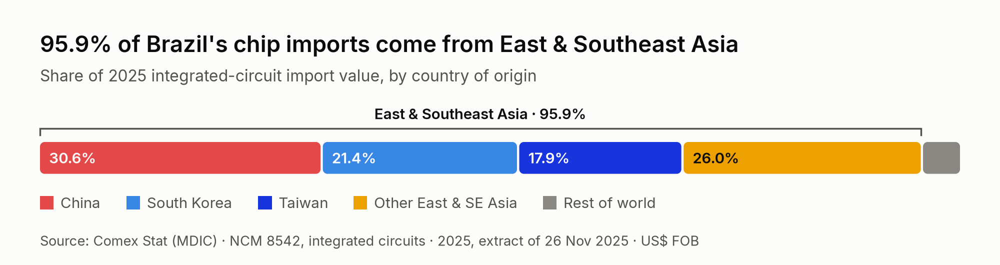
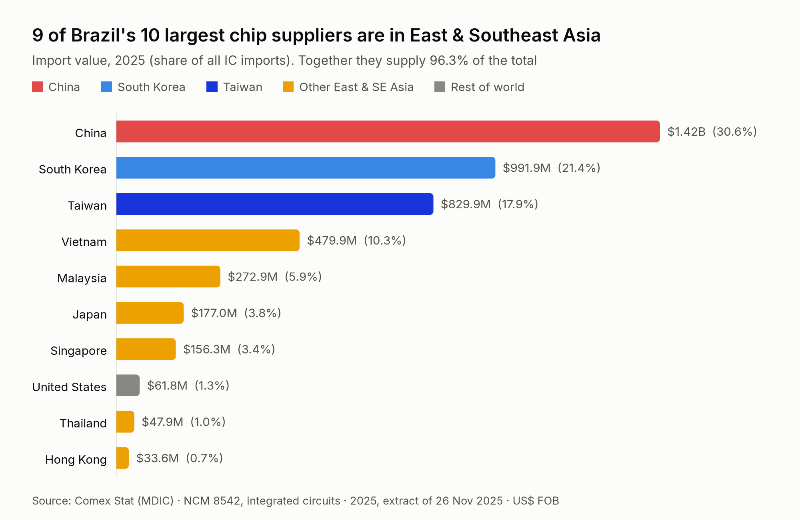
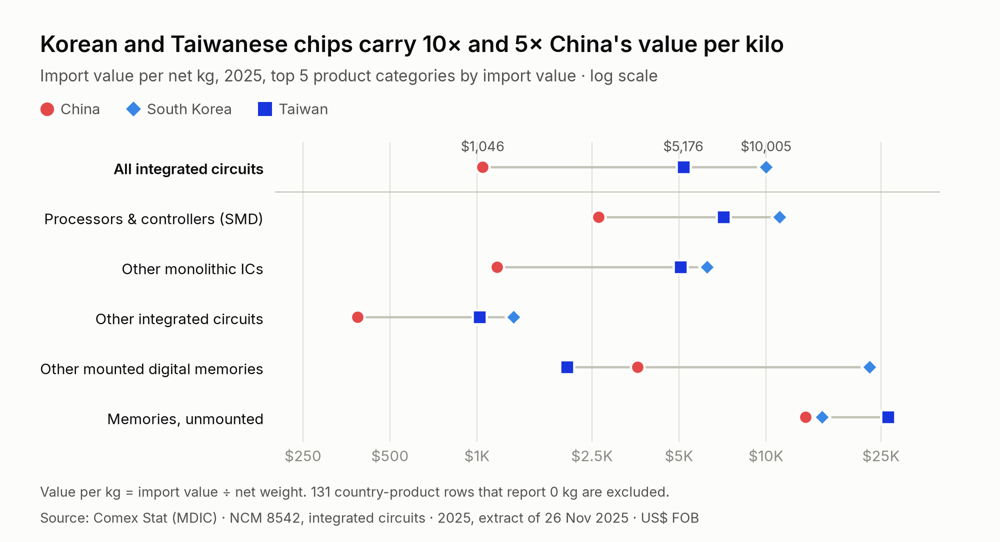
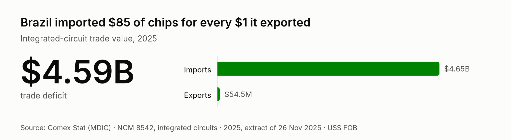

# 🇧🇷 Brazil's Semiconductor Supply Chain Vulnerability

> **Strategic Intelligence Analysis | Supply Chain Risk | Data Analysis | Python, Pandas & Matplotlib**

## 📋 Executive Summary
This project measures Brazil's strategic vulnerability in the global semiconductor market. Using 2025 trade data from Comex Stat, I identified a **critical dependency on East & Southeast Asia**. This dependency exposes the national industry to severe supply chain disruptions if conflicts break out in the region, especially in the Taiwan Strait and the South China Sea.

The goal was to move beyond raw data and provide a **Risk Assessment** for stakeholders in the industrial and technology sectors.

---

## 🚀 Key Strategic Findings

Based on the quantitative analysis of import/export microdata (NCM 8542, integrated circuits), the following strategic risks were identified:

### 1. The "Asian Choke Point"
Brazil does not merely import chips; it relies on a single geopolitical theater.
* **95.9%** of all integrated-circuit imports (by value) originate from East & Southeast Asia.
* **Primary Risks:** Any blockade in the South China Sea or conflict involving Taiwan would essentially paralyze the Brazilian technology sector.

### 2. Massive Trade Deficit
The ratio between Import and Export demonstrates a lack of domestic sovereignty in high-tech manufacturing.
* **Imports:** $4.65 Billion (USD)
* **Exports:** $54.47 Million (USD)
* **Imbalance Ratio:** **85x** more imports than exports.

### 3. Top Tier Dependency
Three players control the flow of technology into Brazil:
1.  🇨🇳 **China:** 30.6% share
2.  🇰🇷 **South Korea:** 21.4% share
3.  🇹🇼 **Taiwan:** 17.9% share

---

## 📊 Data Visualization

Each chart's title states its finding. Each country is drawn in a colour from its own flag: 🇨🇳 China red, 🇹🇼 Taiwan deep blue, 🇰🇷 South Korea light blue, 🇧🇷 Brazil green. The colours were tuned and checked for colour-vision deficiency, and each country keeps its colour in every chart. Values are printed on the marks, so nothing depends on colour alone. The images follow your GitHub light/dark theme, and every chart has a data table below it.

### 🌍 1. The Dependency Map (Origin Share)
*A single segmented bar shows the whole split at a glance: the "Asian Chip Triangle", the rest of East & Southeast Asia, and the rest of the world.*

<picture>
  <source media="(prefers-color-scheme: dark)" srcset="img/01_import_share_by_origin_dark.png">
  
</picture>

<details>
<summary>Data table</summary>

| Origin | Import value | Share |
|---|---:|---:|
| China | $1.42B | 30.6% |
| South Korea | $991.9M | 21.4% |
| Taiwan | $829.9M | 17.9% |
| Other East & SE Asia | $1.21B | 26.0% |
| Rest of world | $192.3M | 4.1% |

</details>

### 📉 2. Top 10 Suppliers & Regional Blocs
*Ranked bars on a common baseline: 9 of the 10 largest suppliers are in East & Southeast Asia, and together the top 10 supply 96.3% of the total.*

<picture>
  <source media="(prefers-color-scheme: dark)" srcset="img/02_top10_suppliers_dark.png">
  
</picture>

<details>
<summary>Data table</summary>

| # | Country | Group | Import value | Share |
|---:|---|---|---:|---:|
| 1 | China | China | $1.42B | 30.6% |
| 2 | South Korea | South Korea | $991.9M | 21.4% |
| 3 | Taiwan | Taiwan | $829.9M | 17.9% |
| 4 | Vietnam | Other East & SE Asia | $479.9M | 10.3% |
| 5 | Malaysia | Other East & SE Asia | $272.9M | 5.9% |
| 6 | Japan | Other East & SE Asia | $177.0M | 3.8% |
| 7 | Singapore | Other East & SE Asia | $156.3M | 3.4% |
| 8 | United States | Rest of world | $61.8M | 1.3% |
| 9 | Thailand | Other East & SE Asia | $47.9M | 1.0% |
| 10 | Hong Kong | Other East & SE Asia | $33.6M | 0.7% |

</details>

### 💎 3. Value per Kilogram (Tech Density)
*Import value per net kg compares China, South Korea and Taiwan within the same product categories. A kilo of Korean chips is worth about 10× a kilo of Chinese chips, and a Taiwanese kilo about 5×. Korea leads in memory and Taiwan in processors, while China ships high volumes of lower-end circuits.*

<picture>
  <source media="(prefers-color-scheme: dark)" srcset="img/03_value_per_kg_dark.png">
  
</picture>

<details>
<summary>Data table (US$ per kg)</summary>

| Product category | China | South Korea | Taiwan |
|---|---:|---:|---:|
| **All integrated circuits** | $1,046 | $10,005 | $5,176 |
| Processors & controllers (SMD) | $2,632 | $11,140 | $7,129 |
| Other monolithic ICs | $1,173 | $6,246 | $5,057 |
| Other integrated circuits | $385 | $1,335 | $1,020 |
| Other mounted digital memories | $3,585 | $22,800 | $2,052 |
| Memories, unmounted | $13,706 | $15,616 | $26,456 |

Rows that report 0 kg (131 country-product rows) are excluded from the value-per-kg calculation.
</details>

### ⚖️ 4. Financial Impact
*For every $1 of chips Brazil exported, it imported $85, a trade deficit of $4.59B.*

<picture>
  <source media="(prefers-color-scheme: dark)" srcset="img/04_trade_balance_dark.png">
  
</picture>

<details>
<summary>Data table</summary>

| Metric | Value |
|---|---:|
| Imports | $4.65B |
| Exports | $54.5M |
| Trade deficit | $4.59B |
| Imports ÷ exports | 85.3× |

</details>

## 🧠 Strategic Recommendation
Based on this data, companies operating in Brazil should:

* **Diversify Origins:** Actively seek suppliers in the "Western Block" (USA, Europe) to mitigate geopolitical risk, despite potentially higher costs.
* **Inventory Buffers:** Increase safety stock for items originating from Taiwan and South Korea (High-End chips).
* **Governance:** Monitor the "Price per Kg" metric to identify shifts in technology density and pricing power.

---

## 🛠 Methodology & Tech Stack

The analysis followed a rigorous data engineering pipeline to ensure accuracy in financial reporting.

* **Data:** Comex Stat (MDIC), NCM 8542 (integrated circuits), import/export value (US$ FOB) and net weight by country, 2025 (extract of 26 Nov 2025): [`H_IMPORTACAO_GERAL_2025-01_2025-12_DT20251126.CSV`](H_IMPORTACAO_GERAL_2025-01_2025-12_DT20251126.CSV).
* **Language:** Python 3.10+
* **Data Manipulation:** `Pandas` (ETL, GroupBy aggregations, country translation, bloc classification by exact country name).
* **Visualization:** `Matplotlib`, with a small custom design system:
  * **Form follows the question:** a segmented bar for part-to-whole, ranked bars for comparison, a dot plot for value per kg, and a headline figure for the deficit. No pie charts and no dual axes.
  * **Flag colours, colour-vision-safe:** each country's flag colour is mapped to a palette step of the same hue, in separate light and dark versions validated for protanopia/deuteranopia separation and contrast. In the dot plot, each country also has its own marker shape (China ●, South Korea ◆, Taiwan ■).
  * **Readable chrome:** thin bars with a 4 px rounded end, solid hairline grids only where they help, and values printed directly on the marks.
  * **Accessibility:** a data table for every chart, alt text, and theme-aware images.
* **Data Governance:** dynamic formatting functions (Billions/Millions) keep figures readable for decision-makers.

```python
# Snippet: Dynamic Financial Formatting Logic used in the project
def money(value):
    """Compact financial figures: $4.65B / $54.5M / $820K."""
    if value >= 1e9:
        return f'${value / 1e9:.2f}B'
    if value >= 1e6:
        return f'${value / 1e6:.1f}M'
    return f'${value / 1e3:.0f}K'
```

**Reproduce:** open `Brazil's_semiconductor_risk_analysis.ipynb` (Jupyter or Google Colab) with the CSV in the same folder and run all cells. The charts are written to `img/`.
